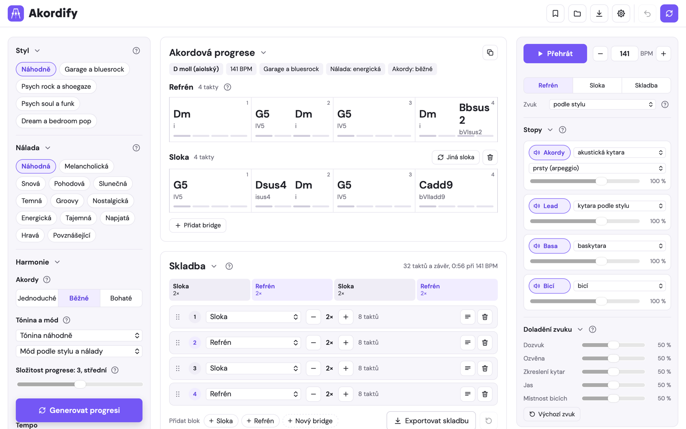
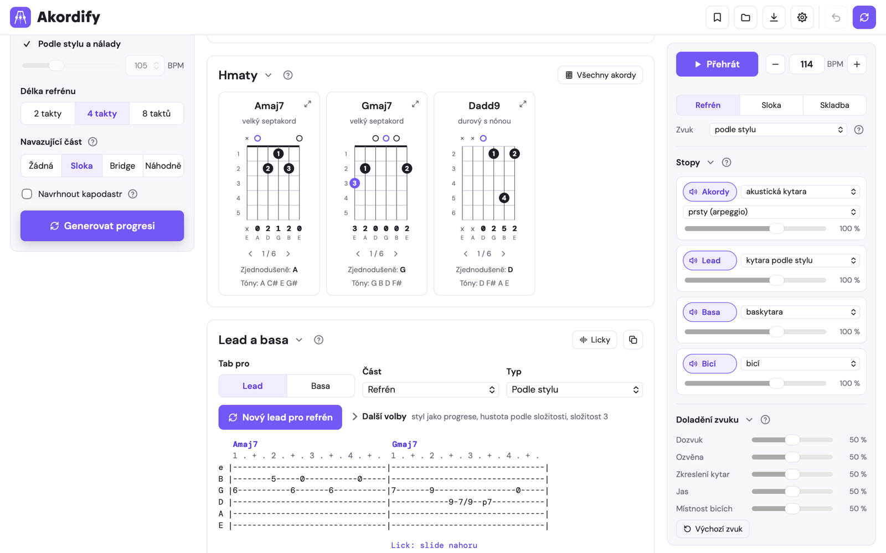
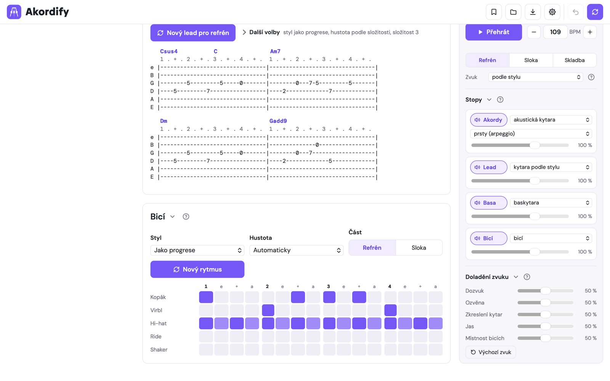
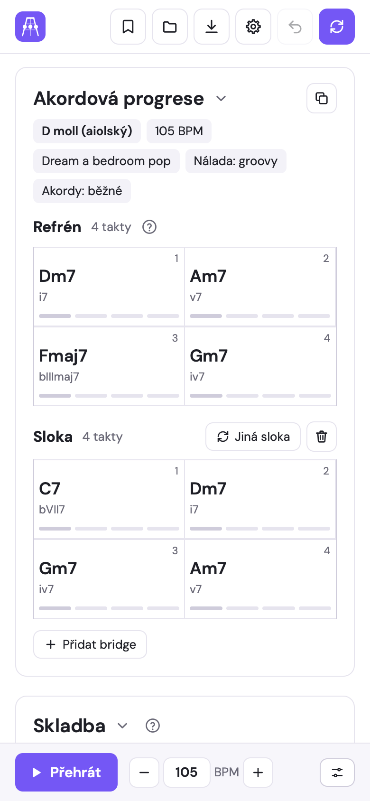
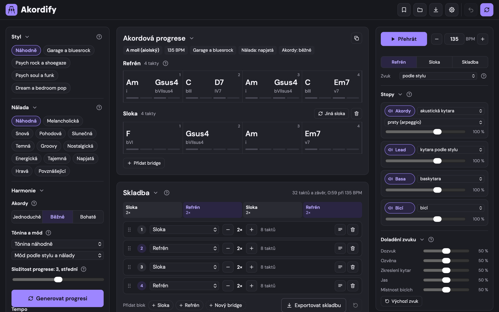

<p align="center">
  
</p>

<h1 align="center">Akordify</h1>

<p align="center">
  <strong>Generátor akordových progresí, hmatů, riffů, basy a bicích pro jam.</strong><br>
  Vyber styl a náladu, klepni na <em>Generovat</em> a máš hotový podklad: akordy s hmaty, kytarový lead v tabulatuře,
  basovou linku, bicí a celou skladbu, kterou si hned přehraješ, nebo ji vyexportuješ do DAW.
</p>

<p align="center">
  <a href="LICENSE"></a>
  
  
  
</p>

<p align="center">
  <a href="https://akordify.cernykafe.com"><strong>▶&nbsp;Vyzkoušet na akordify.cernykafe.com</strong></a>
  &nbsp;·&nbsp;
  <a href="https://github.com/cernykafe/akordify/releases/latest/download/akordify.html">Stáhnout akordify.html</a>
  &nbsp;·&nbsp;
  <a href="docs/navod.md">Příručka</a>
</p>

<p align="center">
  <picture>
    <source media="(prefers-color-scheme: dark)" srcset="docs/img/hlavni-tmavy.png">
    
  </picture>
</p>

---

## Obsah

- [Co Akordify umí](#co-akordify-umí)
- [Ukázky](#ukázky)
- [Jak začít](#jak-začít)
- [Klávesové zkratky](#klávesové-zkratky)
- [Soukromí a data](#soukromí-a-data)
- [Jak je to postavené](#jak-je-to-postavené)
- [Struktura repozitáře](#struktura-repozitáře)
- [Vývoj](#vývoj)
- [Dokumentace](#dokumentace)
- [Licence](#licence)

## Co Akordify umí

### 🎸 Harmonie
- **Akordové progrese podle stylu a nálady.** Čtyři skupiny stylů (garage a bluesrock, psych rock a shoegaze, psych soul a funk, dream a bedroom pop), za každou stojí čtyři stylové profily interpretů. K tomu 12 nálad od melancholické po povznášející.
- **Tónina a mód:** všech 12 tónin a 6 módů (jónský, aiolský, dórský, mixolydický, lydický, frygický), nebo je nech vybrat podle stylu.
- **Tři úrovně akordů** (jednoduché, běžné, bohaté) a **složitost 1 až 5**: od trojzvuků po septimy, sus, add9, vypůjčené akordy, sekundární dominanty a obraty.
- **Forma:** refrén na 2, 4 nebo 8 taktů a k němu sloka nebo bridge, které na smyčku navazují. Každý akord ukazuje i funkci v římských číslicích.
- **Úpravy ručně:** klepnutím na akord dostaneš nabídku akordů, kterými ho jde nahradit. Slokou nebo bridgem můžeš kdykoli zamíchat znovu.
- **Kapodastr:** aplikace najde pozici, kde jde většinu akordů hrát v otevřené poloze.

### ✋ Hmaty
- Diagramy pro kytaru ve standardním ladění s čísly prstů a několika variantami hmatu ke každému akordu.
- Zjednodušená verze akordu a výpis tónů.
- **Všechny akordy:** galerie s hledáním podle názvu, rozumí i české notaci (`Hmi`, `Cis`, `Es`). Naklikáš hmat na hmatníku a aplikace pozná, co je to za akord.

### 🎼 Lead a basa
- **Kytarový lead** jako riff, melodická linka, arpeggio z hmatů nebo dvojhmaty, s technikami hammer-on, pull-off, slide, bend a vibrato.
- **Licky:** typické fráze v pentatonice, které se dají do linky přimíchat. Najdeš je i v samostatné galerii.
- **Basová linka** pro čtyřstrunnou baskytaru: osminy na kořenech, kořen-kvinta-oktáva, synkopovaný groove, melodická linka nebo dlouhé tóny.
- Všechno jako **textová tabulatura** po taktech, připravená ke zkopírování.

### 🥁 Bicí
- Generátor rytmů pro kopák, virbl, hi-hat, ride a shaker. Sloka hraje klidnější verzi refrénu, bridge vlastní variantu a na konci částí přichází přechod.
- **Mřížka 16 šestnáctin**, ve které jde každý úder zapnout nebo vypnout klepnutím.

### 🔊 Přehrávač a zvuk
- Všechny zvuky vznikají **syntézou přímo v prohlížeči**. Nejsou tu žádné samply ani nic, co by se stahovalo. Struny jsou fyzikální model (Karplus-Strong) Telecasteru a baskytary Precision a bicí jsou syntetizované.
- Nástroje pro akordy: akustická a elektrická kytara, elektrické piano, varhany, syntezátor, pad. Hrát se dají prsty, jedním úhozem nebo brnkáním.
- Lead: čistá, zkreslená i akustická kytara, elektrické piano, varhany, vibrafon, syntezátor, 8bit, flétna.
- Hlasitost a ztlumení každé stopy, doladění dozvuku, ozvěny, zkreslení, jasu a místnosti bicích.
- Přehrávání refrénu, sloky nebo celé skladby, i dokola. Tempo 40 až 240 BPM.

### 🧩 Skladba, ukládání a export
- **Sled bloků skladby:** sloky, refrény a bridge s počtem opakování a textem písně. Pořadí se mění přetažením.
- **Uložené nápady** v prohlížeči, s exportem a importem do souboru JSON.
- **Export MIDI** (standardní MIDI soubor, formát 1) po stopách nebo všechno najednou v ZIPu, připravený pro Logic, Ableton, Reaper a další DAW.
- **Export WAV:** mix z přehrávače vykreslený bez ztlumených stop.
- **Sdílení odkazem:** celý nápad se zakóduje do adresy a nikam se neodesílá.
- **Kopírování jako text:** akordy, hmaty a text písně do schránky.
- Krok zpět a znovu u všeho, historie generování.

### 🎨 Pohodlí
- Světlý a tmavý vzhled, 8 barev prostředí, značení tónů **H a B** (česky) nebo **B a Bb** (anglicky).
- Vlastní rozvržení: bloky v levém panelu, výsledcích a přehrávači si můžeš přeskládat.
- Nápověda s otazníky u každé části a krátký úvodní návod.
- Responzivní rozhraní pro mobil, tablet i desktop. Instaluje se jako aplikace (PWA) a funguje bez připojení.

## Ukázky

| Hmaty a tabulatura | Bicí a přehrávač |
| --- | --- |
|  |  |

| Mobil | Tmavý vzhled |
| --- | --- |
|  |  |

## Jak začít

Akordify je jediný HTML soubor. Nepotřebuje server, sestavení ani instalaci balíčků.

**1. Online (nejrychlejší).**
Otevři **<https://akordify.cernykafe.com>**. Web si můžeš nainstalovat jako aplikaci: v Chrome a Edge ikonou instalace v adresním řádku, na iPhonu přes *Sdílet → Přidat na plochu*. Po prvním otevření funguje i bez připojení.

**2. Samostatný soubor.**
Stáhni [`akordify.html`](https://github.com/cernykafe/akordify/releases/latest/download/akordify.html) z posledního vydání a otevři ho dvojklikem. Funguje v jakémkoli moderním prohlížeči i bez internetu.

**3. Lokálně z repozitáře, jako webová aplikace (PWA).**

```bash
git clone https://github.com/cernykafe/akordify.git
cd akordify
python3 -m http.server 8000 --directory public
```

Pak otevři <http://localhost:8000>. Na `localhost` se zaregistruje i service worker, takže si aplikaci můžeš nainstalovat a zkusit práci bez připojení.

**4. Na vlastní web.** Složka [`public/`](public) je připravená k nasazení na Cloudflare Pages i na jakýkoli statický hosting. Postup je v [docs/nasazeni.md](docs/nasazeni.md).

## Klávesové zkratky

| Klávesa | Akce |
| --- | --- |
| <kbd>Mezerník</kbd> | přehrát / zastavit |
| <kbd>N</kbd> | nová progrese |
| <kbd>Ctrl</kbd>/<kbd>⌘</kbd> + <kbd>S</kbd> | uložit nápad |
| <kbd>Ctrl</kbd>/<kbd>⌘</kbd> + <kbd>Z</kbd> | krok zpět |
| <kbd>Esc</kbd> | zavřít dialog |

## Soukromí a data

- Aplikace **nic neposílá na server**. V kódu není jediný síťový požadavek mimo vlastní soubory stránky, žádná analytika ani cookies.
- Nastavení, poslední stav a uložené nápady zůstávají v `localStorage` tvého prohlížeče. Nainstalovaná aplikace požádá prohlížeč o trvalé úložiště, aby nápady nesmazal.
- Odkaz pro sdílení nese nápad v části adresy za `#`, kterou prohlížeč serveru neposílá.
- Hlavičky pro Cloudflare Pages zakazují přístup ke kameře, mikrofonu a poloze a vyhledávačům říkají, ať web neindexují (`X-Robots-Tag: noindex`).

## Jak je to postavené

- **Čisté HTML, CSS a JavaScript** (ES5) bez frameworků, knihoven a sestavovacích nástrojů. Písma DM Sans a DM Mono jsou vložená přímo do stránky.
- **Hudební teorie a generátory:** deterministický generátor náhody (mulberry32) se semínkem, model přechodů mezi harmonickými funkcemi, hodnocení kandidátních sledů akordů, stylové profily s váhami módů, akordů, rytmů a technik.
- **Hmatník:** hmaty se hledají prohledáním a ohodnocením tvarů na hmatníku, lead se na struny mapuje dynamickým programováním.
- **Zvuk:** vlastní syntéza ve Web Audio API. Struny modeluje Karplus-Strong s frakčním zpožděním, místem úhozu a snímači, filtry jsou bikvadratické podle RBJ Audio EQ Cookbook, bicí a dozvuky se syntetizují do bufferů. WAV se vykresluje přes `OfflineAudioContext`.
- **Export:** vlastní zápis MIDI souborů a ZIP archivu bez komprese, bez knihoven.
- **PWA:** manifest a service worker (nejdřív síť, při výpadku uložená kopie), ikony včetně maskable.

Podrobný popis modulů, datového modelu a formátů je v [docs/architektura.md](docs/architektura.md).

## Struktura repozitáře

```
akordify/
├── public/                  web k nasazení (zdroj pravdy)
│   ├── index.html           celá aplikace: HTML, CSS, JavaScript, písma
│   ├── sw.js                service worker pro práci bez připojení
│   ├── manifest.webmanifest manifest pro instalaci jako aplikace
│   ├── _headers             bezpečnostní hlavičky pro Cloudflare Pages
│   └── icons/               ikony aplikace (SVG, PNG, maskable)
├── scripts/
│   └── build.py             verze service workeru + samostatný akordify.html
├── docs/
│   ├── navod.md             uživatelská příručka
│   ├── architektura.md      technická dokumentace
│   ├── nasazeni.md          nasazení a provoz
│   └── img/                 snímky obrazovky
├── LICENSE
└── README.md
```

## Vývoj

Aplikace se upravuje přímo v [`public/index.html`](public/index.html). Po změně spusť:

```bash
python3 scripts/build.py
```

Skript přepočítá verzi v `public/sw.js` podle obsahu (aby si prohlížeče po nasazení stáhly novou verzi) a vyrobí `dist/akordify.html`, samostatný soubor bez service workeru s ikonou vloženou do stránky. Stačí mu Python 3.8 a novější, žádné balíčky.

Před commitem můžeš ověřit, že verze service workeru sedí:

```bash
python3 scripts/build.py --check
```

## Dokumentace

- 📖 [Uživatelská příručka](docs/navod.md): jak aplikaci používat, část po části
- 🛠️ [Architektura](docs/architektura.md): moduly, datový model, zvukový engine, formáty uložení a sdílení
- 🚀 [Nasazení](docs/nasazeni.md): Cloudflare Pages, jiný hosting, lokální spuštění, aktualizace

## Licence

Kód je pod licencí [MIT](LICENSE).

Písma **DM Sans** a **DM Mono** vložená do stránky se šíří pod licencí [SIL Open Font License 1.1](https://openfontlicense.org).
Jména interpretů slouží jen jako popis stylu. Aplikace neobsahuje žádné nahrávky ani noty, jen akordové postupy a vlastní generátory.
